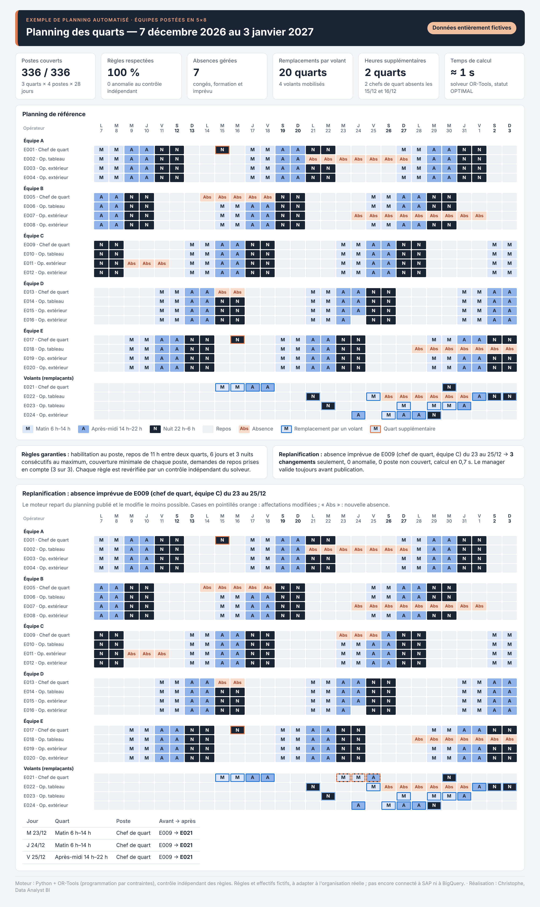
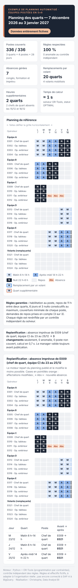
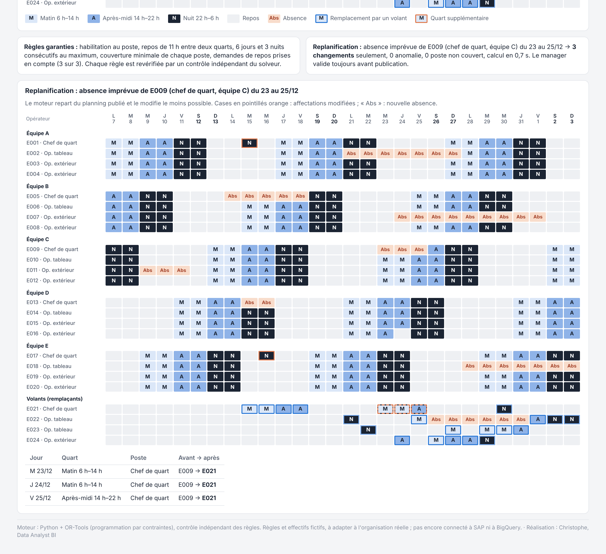

# Planning automatisé des équipes postées (5×8)

Prototype de démonstration pour un site industriel fonctionnant en continu : le planning des
opérateurs postés est **calculé automatiquement** en respectant les règles de sécurité et de
temps de travail, puis **replanifié en moins d'une seconde** quand une absence imprévue arrive.
**Le manager valide toujours** avant publication.

Aujourd'hui, ce planning est souvent construit à la main dans Excel ou Power Apps, à partir
d'exports SAP. Le prototype montre comment remplacer ce travail par un calcul fiable, contrôlé
et explicable.

> **Données entièrement fictives.** Opérateurs, effectifs, absences et règles sont inventés pour
> l'illustration. Aucun nom de client ni d'entreprise.

**Voir le planning en ligne :** https://cak91dy.github.io/planning-equipes-postees/



<details>
<summary>Version téléphone</summary>


</details>

## Version interactive : congés, RTT, absences et assistant

**Ouvrir :** https://cak91dy.github.io/planning-equipes-postees/interactif/ (dossier [`docs/interactif/`](docs/interactif/))

Le même planning en 5×8, que le manager pilote directement dans son navigateur :

- **point de départ** : le planning optimal calculé par OR-Tools (`output/planning.csv`) ;
- **absences, congés payés, RTT, formations** : compteurs par personne, demandes en attente à étudier
  ou refuser, décompte en quarts planifiés ;
- **assistant en français** : « Antoine est en arrêt du 23 au 25 décembre », « RTT pour Camille le
  26/12 », « Qui peut remplacer le chef de quart de nuit le 15 ? », « Combien de congés reste-t-il à
  Manon ? » ;
- **recalcul en quelques millisecondes**, avec les mêmes règles que le moteur OR-Tools : volant d'abord,
  puis échange entre collègues du même quart, puis quart supplémentaire en dernier recours. Un poste
  impossible à couvrir est signalé, jamais caché ;
- **validation par le manager** : chaque changement est présenté comme une proposition (postes
  réaffectés, quarts supplémentaires, contrôle des règles), puis publié ou abandonné ;
- modification case par case, correction automatique, effectifs et habilitations modifiables,
  historique des décisions.

Le moteur JavaScript de la page retrouve **exactement** la replanification d'OR-Tools sur le scénario de
référence (test `tests/test_interactif.py`). La page tourne sans serveur ; les modifications restent dans
le navigateur de la personne qui l'utilise. L'assistant comprend des phrases simples par règles, sans IA
externe ni clé d'API dans la page ; en production, ce rôle peut être confié à Claude via un serveur
(`src/planning/assistant.py`). Prénoms et compteurs de congés sont des exemples.

## Résultats (planning de référence, 7 décembre 2026 → 3 janvier 2027)

| | Résultat |
|---|---|
| Effectif | 24 opérateurs : 5 équipes de 4 (1 chef de quart, 1 opérateur tableau, 2 opérateurs extérieur) et 4 volants |
| Postes couverts | **336 sur 336** (3 quarts × 4 postes × 28 jours), aucun trou |
| Contrôle indépendant | **0 anomalie** sur les 8 règles vérifiées |
| Absences intégrées | 7 périodes (congés, formation, imprévu) |
| Remplacements par volant | 20 quarts, répartis à égalité entre les 4 volants (5 chacun) |
| Heures supplémentaires | **2 quarts seulement** : deux chefs de quart sont absents les 15 et 16/12 et un seul volant est habilité chef |
| Demandes de repos | 3 respectées sur 3 |
| Temps de calcul | ≈ 1 s (statut OPTIMAL : meilleur planning possible au sens des règles) |

Sources : `output/rapport.json` et `output/anomalies.csv`. La page web recalcule ces
indicateurs depuis ces fichiers ; aucun chiffre n'y est écrit en dur.

### Replanification : une absence imprévue après publication

Scénario : **E009, chef de quart de l'équipe C, est absent du 23 au 25 décembre.** Le moteur
repart du planning publié et le modifie le moins possible.

| | Résultat |
|---|---|
| Changements | **3** : le volant chef E021 reprend les 3 quarts de E009 |
| Affectations inchangées | 333 sur 336 |
| Contrôle | 0 anomalie, 0 poste non couvert |
| Temps de calcul | 0,7 s (même résultat sur 5 calculs successifs) |



## Les règles appliquées

Toutes les règles sont dans [`config/regles.yaml`](config/regles.yaml), lisible et modifiable sans
toucher au code. Les valeurs sont des **hypothèses**, à valider avec les RH et l'exploitation.

**Règles dures**, jamais enfreintes :
- habilitation : chacun ne tient que les postes pour lesquels il est habilité ;
- aucune affectation pendant une absence ;
- un seul quart par jour ;
- **11 h de repos minimum** entre deux quarts : interdit de passer d'après-midi à matin, de nuit à
  matin, ou de nuit à après-midi ;
- **6 jours** et **3 nuits** consécutifs au maximum, en tenant compte des jours travaillés avant
  le début du planning ;
- 20 quarts au maximum sur les 28 jours.

**Couverture** : chaque quart demande 1 chef de quart, 1 opérateur tableau et 2 opérateurs
extérieur, soit 12 postes par jour. Si c'est impossible, le trou est **signalé**, jamais caché.

**Objectifs souples**, arbitrés par les pondérations de `regles.yaml` :
- suivre le cycle 5×8 (MM AA NN RRRR, décalé de 2 jours entre les équipes) ;
- éviter les heures supplémentaires ;
- ne mobiliser les volants que pour remplacer ;
- répartir équitablement la charge et les nuits des volants ;
- respecter les demandes de repos ;
- garder chacun sur son poste habituel autant que possible.

En replanification, la priorité devient de **changer le moins possible** le planning publié.

## Comment ça marche

```
data/*.csv ──► solveur OR-Tools ──► output/planning.csv ──► contrôle indépendant ──► page web
(opérateurs,   (programmation par     (une ligne par         (revérifie chaque       (docs/index.html)
 absences…)     contraintes)           affectation)            règle)
```

| Fichier | Rôle |
|---|---|
| `config/regles.yaml` | règles, horaires des quarts, cycle 5×8, pondérations |
| `data/` | entrées fictives : opérateurs, habilitations, besoins, absences, demandes de repos |
| `src/planning/solveur.py` | cœur du moteur : modèle OR-Tools CP-SAT |
| `src/planning/controle.py` | **contrôle indépendant** : relit le planning et revérifie chaque règle, sans réutiliser le solveur |
| `src/planning/main.py` | commande principale : données → solveur → contrôle → fichiers de sortie |
| `src/planning/assistant.py` | assistant Claude : le manager écrit « E009 absent du 23 au 25 décembre », l'assistant appelle le moteur et explique la proposition. **Il ne peut pas publier** |
| `src/planning/bigquery_io.py` | prévu pour la production : lecture et écriture dans BigQuery |
| `output/planning.csv` | **planning de référence** (celui présenté), à ne pas écraser |
| `output/replanif/` | démonstration de replanification (données du scénario et résultat) |
| `scripts/generer_page.py` | produit la page `docs/index.html` à partir des fichiers de sortie |
| `scripts/demo_replanification.py` | rejoue le scénario de l'absence de E009 |
| `docs/interactif/` | version interactive : moteur (`moteur.js`), assistant (`assistant.js`), interface (`app.js`), données (`donnees.js`, produit par `scripts/generer_donnees_interactif.py`) |
| `tests/` | 12 tests automatiques : règles, replanification, renfort ponctuel, assistant, page, version interactive (avec Node.js) |

**Répartition des rôles.** Le solveur calcule et garantit les règles. Le contrôle vérifie.
L'assistant IA comprend la demande et explique. **Le manager décide.**

## Lancer le projet

Prérequis : Python 3.10 ou plus récent.

```bash
pip install ortools pandas pyyaml pytest
```

```bash
PYTHONPATH=src python -m planning.main --donnees data --sortie output/recalcul
```

```bash
python -m pytest tests
```

Sous Windows PowerShell, définir d'abord `$env:PYTHONPATH="src"`.

Écrire le calcul dans `output/recalcul` préserve le planning de référence. Un nouveau calcul peut
donner un planning **différent mais tout aussi valide** : plusieurs plannings atteignent le même
score, et le contrôle garantit les règles dans tous les cas.

Rejouer la replanification et régénérer la page :

```bash
python scripts/demo_replanification.py
```

```bash
python scripts/generer_page.py
```

Assistant Claude (facultatif) : `pip install -r requirements.txt`, puis définir
`ANTHROPIC_API_KEY`, ou `CLAUDE_VIA_VERTEX=1` et `GCP_PROJECT` pour Vertex AI, dans un fichier
`.env` (ignoré par git). Lancer ensuite `PYTHONPATH=src python -m planning.assistant`.

## Limites

- **Règles et effectifs fictifs.** Le cycle réel, l'accord d'entreprise, la convention collective
  et les habilitations doivent être recueillis avec les RH et l'exploitation.
- **Pas encore connecté** aux données SAP ni à BigQuery. Le module `bigquery_io.py` est prévu pour
  cela ; le prototype lit des CSV.
- **Assistant testé sans appel réel à Claude.** Les tests simulent ses réponses ; un essai avec une
  clé d'API reste à faire.
- **Horizon fixe de 28 jours.** L'équité entre opérateurs sur l'année, l'enchaînement d'un mois à
  l'autre et les préférences individuelles détaillées ne sont pas encore traités.
- **Validation humaine obligatoire.** Le moteur propose, le manager publie : aucun planning n'est
  publié automatiquement.

---

Réalisation : Christophe, Data Analyst BI — Python, optimisation (OR-Tools), SQL, Power BI.
